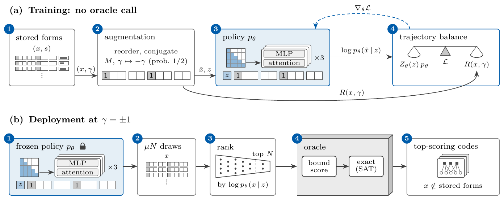
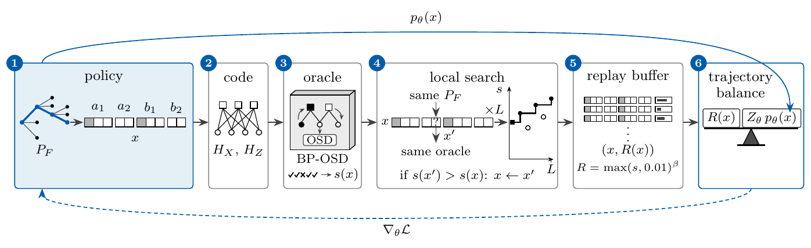

# GFlowQEC

Code and data for *GFlowQEC: Generative Flow Networks that Learn to Sample Quantum LDPC Codes* by Nuno Batista, Gabriel Falcão and Penousal Machado (2026). GFlowQEC trains generative flow networks to propose quantum LDPC codes (two-block and lifted-product codes over finite groups) and certifies the minimum distances of the top-scoring codes at n = 180 exactly (an exhaustive sweep and a SAT ladder). The offline variant learns from stored codes without calling the oracle and is then deployed frozen; the online variant pays the oracle as it trains, with local search and a replay buffer.

Paper: the full version is in [`paper/GFlowQEC-full.pdf`](paper/GFlowQEC-full.pdf).

Archive: release v1.1 is on Zenodo, DOI [10.5281/zenodo.23922222](https://doi.org/10.5281/zenodo.23922222).





The tag v1.1 is the code behind the full version of the paper, and its `data/MANIFEST.md5` pins the data by md5. The tag v1.0 is the first release. Later commits may add to them.

## Install

Python 3.12. From the repository root:

```
pip install -r requirements.txt
```

Everything runs from the root as a module (`python -m ...`). There is no package to install.

`readouts.fig_main300` draws its labels with LaTeX (matplotlib `text.usetex`), so it needs `latex` on the path, for example from `apt install texlive-latex-extra cm-super dvipng` on Debian or Ubuntu. Nothing else needs LaTeX, and without it pytest skips that one test.

## Get the data

The data, with ten seeds of the main runs (0-9 at n = 180, and 0-5 and 7-10 at n = 300), is in the Hugging Face dataset [`NunoBatista/gflowqec-data`](https://huggingface.co/datasets/NunoBatista/gflowqec-data).

```
pip install huggingface_hub
python -m scripts.fetch_data
```

This downloads about 1.9 GB into `data/` and checks every file against `data/MANIFEST.md5`. `python -m scripts.fetch_data --check-only` repeats the check without downloading. The script downloads the dataset at its revision `v1.1`, the one this tag reads, and the check ties the files to it. A checkout of release v1.0 should fetch the dataset at revision `v1.0` instead (`snapshot_download(..., revision="v1.0")`): v1.1 replaced `data/n300/bo_rescore_cache.json` and added 518 files.

Stored file names keep a short prefix naming the run family that wrote them (for example `r174_` or `r177_`). The prefix is a name only. The docstring of `gflowqec/counts.py` says what each n = 180 family holds.

## Quick start

Sample codes from a trained GFlowQEC-offline policy at n = 180 and certify one distance exactly. This takes a few seconds on a laptop CPU once the data is in place.

```python
import torch
from gflowqec.certify import exact_sectors
from gflowqec.codes import build, generates_g, group_for, identity_index
from gflowqec.oracle import cond_vec, lam_of
from gflowqec.paths import DATA
from gflowqec.policy import TupleTransformer

# The n = 180 arena: lifted-product codes over G = Z_6 x S_3 (36 elements, n = 5|G|)
G = "C6xS3"
elements = group_for(G)[1]

# A trained GFlowQEC-offline policy (seed 0)
policy = TupleTransformer(len(elements))
policy.load_state_dict(torch.load(DATA / "models" / "r177_transformer_w18_b256_x20_s0.pt")["state"])

# Sample 16 codes for Z-biased noise (p_Z = 10 p_X); keep the first 5 whose elements generate G
torch.manual_seed(0)
cond = torch.tensor([cond_vec(lam_of(10, "Z"))] * 16)
tuples, _ = policy.sample(16, cond, identity_index(G))
picks = [t for t in tuples.tolist() if generates_g(G, t)][:5]

# A code is ten indices into `elements` (24 is the identity e; print(elements[i]) shows element i):
# A = [g1 + g2 + g3, e + g4 + g5], B = [h1 + h2 + h3, e + h4 + h5]
for t in picks:
    code = build(G, t)
    print(f"[[{len(code)}, {code.dimension}]]  g = {t[:5]}  h = {t[5:]}")
# [[180, 36]]  g = [24, 13, 3, 34, 10]  h = [24, 5, 10, 11, 8]   (then four more codes)

# Certify the first code's distance exactly: one SAT ladder per sector, d = min(d_X, d_Z)
# (exact_sectors names each sector by its check matrix, so its d_X is the paper's d_Z)
dX, exact_X, dZ, exact_Z = exact_sectors(build(G, picks[0]))[:4]
print(f"d_X = {dX}, d_Z = {dZ}, exact: {exact_X and exact_Z}")   # d_X = 6, d_Z = 6, exact: True
```

## Reproduce the paper

```
python -m readouts.sum180      # prints Table 3, certified columns (iso180 prints the Inequivalent ones)
python -m pytest tests -q      # checks every readout against its expected output
```

Each readout prints one table, figure or section of the paper from the stored runs in `data/`. Readouts train nothing and call no oracle. Each docstring names the paper item it prints.

Table, figure and section numbers follow the full version (`paper/GFlowQEC-full.pdf`), and so do the seeds: 0-9 at n = 180 (1-9 for the pilot screen at 100 times) and 0-5 and 7-10 at n = 300 (seed 6 was the tuning seed). The processor-second comparisons at n = 180 and the relational variant read seeds 0-2, as in the paper. At n = 300 the depth-31 sentence and the tuned PT range choice read seeds 0-5, the seeds those choices were made on.

Lines that begin `Not in the paper:`, and the items marked repository only below, print results the full version does not. Lines that begin `basis:` (the counts behind a number) or `timed:` (wall time) are diagnostics, and the tests skip them.

| Paper item | Readout |
|---|---|
| Table 1 (prior code searches) | none, literature only |
| Sec. 2 and Sec. 3 text | none, literature and definitions |
| Fig. 1 (Tanner graph of the [[4,2,2]] code), Fig. 2 (GFlowNet toy) | none, definitions only |
| Table 2 (answer keys and reference sample) and Sec. 4.3 text | `keys`, `stored_forms` (the certification threshold) |
| Fig. 3 (GFlowQEC-offline pipeline) | none, schematic (`figures/pipeline-offline.png`) |
| Sec. 5.2 text (beta = 8) | `nets` |
| Sec. 5.3 text (stored runs, paid calls, stored forms, ten models) | `stored_forms`, `nets` (the ten models) |
| Sec. 5.4 text (legal tuples per canonical form, the 16 reorderings, the earlier unranked deployment) | `stored_forms`, `res_prefix` (note b) |
| Sec. 6.1 text (comparison methods) | `methods` (the screen's choice on a held-out tenth); its other numbers are settings fixed in code |
| Table 3 (results at 180 qubits): Certified top-scoring codes columns | `sum180` (its neighbourhood columns are repository only) |
| Table 3: Inequivalent columns | `iso180` |
| Sec. 7 text (n = 180 results) | `text180`, `iso180` (inequivalent ratios, runs above two), `res_prefix` (per-seed counts, the policy as a ranker), `hyb180` (screen ranking the policy's draws), `cost180` (Cost paragraph) |
| Sec. 1, Sec. 9 and abstract (headline numbers) | `iso180` (inequivalent ratios), `text180` (the supervised screen, soft Q-learning), `hyb180` (screen ranking the policy's draws), `keys` (share of top-scoring random codes), `oracle_costs` (cost per code), `background` (size of the n = 300 space) |
| Sec. 8 (discussion) | `sum180`, `cost180`, `res_prefix`, `cal36`, `cal72`, `sum300` |
| App. A.2 and App. A.4 text | `family_counts` |
| Table A.1 (oracle cost per paid call) | `oracle_costs` (its n = 36 and n = 300 cells come from `scripts.time_oracle`) |
| App. A.1, App. A.3 and App. B.2 | none, definitions only |
| App. B text (legal tuples, reward floor) | `stored_forms` |
| Table B.1 (networks) | `nets` (the PPO update range at n = 180 is read from the stored models of seeds 0-2); `settings` also prints, not in the paper, the screen's training length as a share of the policy's |
| App. B.1 text (stored forms, pilot, relational variant) | `stored_forms`, `rel180` |
| App. C text (budgets, y* range) | `protocol` |
| Table C.1 (comparison methods as run) | `methods` |
| App. C.1 text (additional runs) | none, a list of pilot runs |
| Table C.2 and App. C.2 text (statistical procedures) | `stats_appendix` |
| Table D.1 (per-seed results at n = 180) and its notes | `res_prefix` |
| App. D.1 text | `iso180` (inequivalent ratios and single-seed ranges), `text180` (exact-ladder runs per code), `res_prefix` (unranked deployment, note b), `more180` (sorting by k) |
| App. D.2 (proportional sampling at 36 and 72 qubits) | `cal36` (n = 36), `cal72` (n = 72), `res_prefix` (the Unranked deployment row's ratio, the last paragraph's more than five and a half times) |
| App. E intro and App. E.1 text (beta = 64, size of the space, y*) | `nets` (beta), `background` (size of the space), `settings` (y*) |
| Table E.1 (comparisons at 300 qubits) | `sum300` |
| App. E.2 text (n = 300 results) | `text300`, `res300` (the soft Q-learning and PPO values), `fig_main300` (the depth 31 sentence), `methods` (the best of five sentence) |
| App. E.2 text (objective swap, k = 60, best codes) | `more300` |
| GFlowQEC-online pipeline diagram | none, schematic (`figures/pipeline-online.png`); repository only |
| Comparisons at 300 qubits (figure) | `fig_main300`; repository only |
| Further runs at 300 qubits (table) | `res300`; repository only, App. E.2 quotes two of its rows |

## Regenerate the data

The scripts in `scripts/` rerun the experiments from scratch and write to `results/`, never to `data/`. Some take hundreds of CPU-hours; each docstring gives the commands, seeds and cost. Reruns agree closely across machines but not bit for bit.

## Layout

```
gflowqec/   library: codes, oracles, distance certifier, policies, comparison methods
readouts/   one script per paper table, figure or section
scripts/    data download and experiment reruns
data/       answer keys, stored runs and trained networks
tests/      checks for every readout and the data manifest
figures/    the two pipeline diagrams
paper/      the full version of the paper (PDF)
```

## License and citation

Code is MIT (`LICENSE`), data is CC BY 4.0 (`LICENSE-DATA`), and third-party licenses are listed in `THIRD-PARTY.md`. The paper PDF in `paper/` is the authors' version; all rights reserved by the authors.

If you use this work, please cite the paper (`CITATION.cff`). Release v1.1 is archived on Zenodo, DOI [10.5281/zenodo.23922222](https://doi.org/10.5281/zenodo.23922222).
